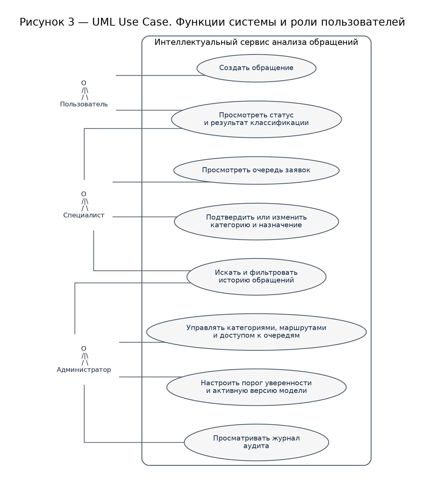
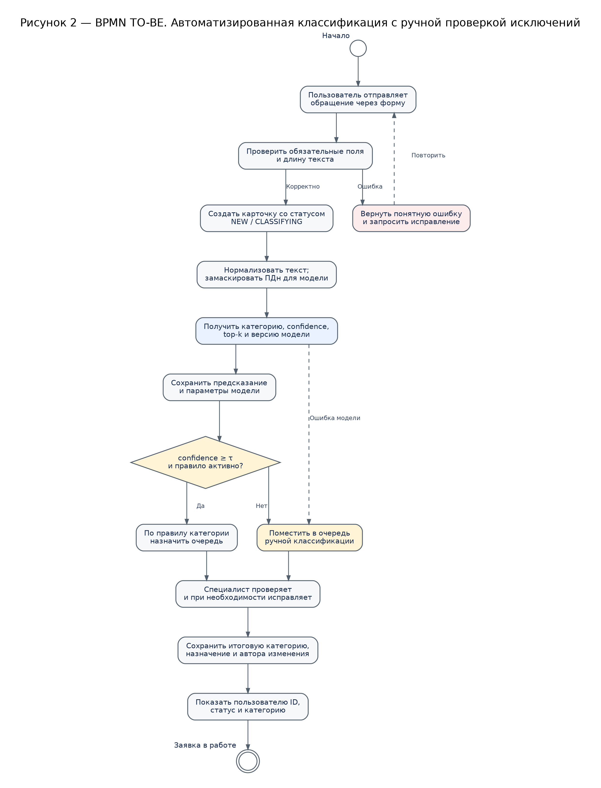
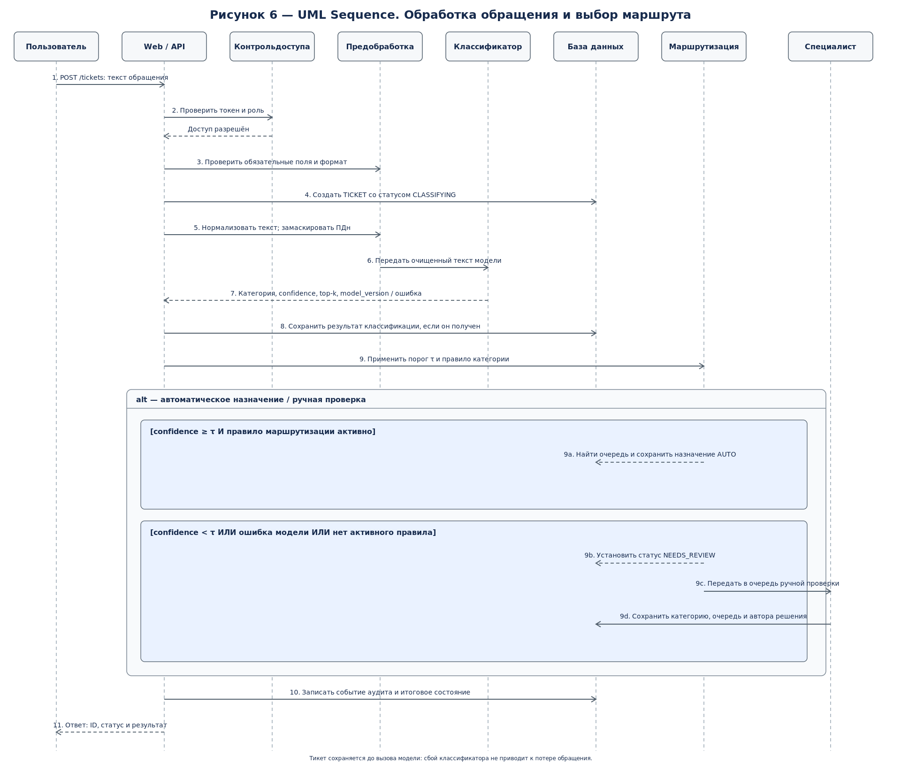
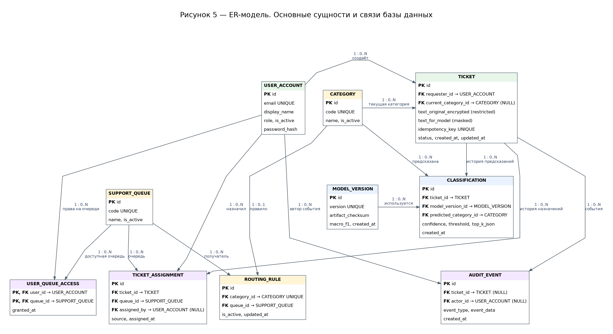
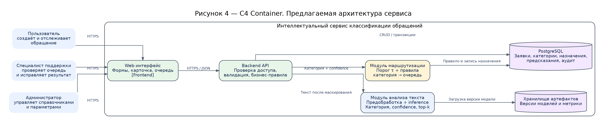
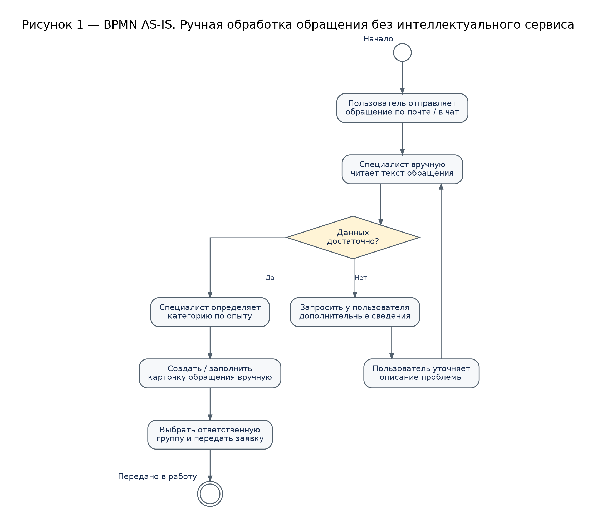

# Лабораторная работа № 3. Проектирование информационных систем

**Тема ВКР:** «Разработка интеллектуального сервиса для автоматизированного анализа и классификации обращений пользователей в службу технической поддержки»  
**Автор:** Галимзянов И. Ф.  
**Репозиторий проекта:** [VKR-support-ticket-classifier](https://github.com/VaniaGalimzianov/VKR-support-ticket-classifier)  
**Дата подготовки:** 27 ноября 2026 г.

> **Границы проектирования.** В отчёте представлена целевая модель разрабатываемого сервиса. Диаграммы описывают проектируемое поведение и архитектуру, а не утверждают, что все перечисленные компоненты уже реализованы в программном коде. Сервис автоматизирует первичную классификацию и маршрутизацию заявок, но не заменяет специалиста и не решает техническую проблему вместо него.

## 1. Предметная область и требования

### 1.1. Описание предметной области

Служба технической поддержки получает обращения пользователей о неисправностях оборудования, проблемах с программным обеспечением, доступом к информационным системам, настройкой рабочих мест и других технических вопросах. В исходном процессе специалист должен прочитать текст обращения, определить его тему, выбрать ответственную группу и внести информацию в систему учёта. При большом количестве заявок такая работа увеличивает время первичной обработки и создаёт риск неодинаковой классификации похожих обращений.

Разрабатываемая информационная система предназначена для автоматизации первичного анализа текстового обращения. После поступления заявки сервис проверяет корректность данных, подготавливает текст, передаёт его модели машинного обучения и получает предполагаемую категорию, оценку уверенности и дополнительные варианты категорий. Далее применяется правило маршрутизации: заявка с достаточно высокой уверенностью может быть направлена в соответствующую очередь, а сомнительная заявка либо заявка без настроенного правила передаётся специалисту на ручную классификацию.

В системе выделяются три основные роли:

- **Пользователь** — создаёт обращение и просматривает его статус и результат обработки.
- **Специалист технической поддержки** — просматривает очередь, проверяет предсказание модели, при необходимости исправляет категорию и назначение.
- **Администратор** — управляет справочником категорий, правилами маршрутизации, порогом уверенности и активной версией модели; просматривает журнал аудита.

В рамках первой версии ВКР рассматриваются приём текстовых обращений, классификация, маршрутизация, ручная проверка и учёт результатов. Автоматическое формирование ответа пользователю, диагностика неисправности, интеграция со всеми внешними help-desk-системами и автоматическое переобучение модели не входят в обязательную границу первой версии. В дальнейшем сервис может быть подключён к существующей системе регистрации заявок через API.

**Основной сценарий:** пользователь отправляет обращение → система сохраняет заявку → выполняет предварительную обработку текста → получает предсказание модели → проверяет уверенность и наличие правила маршрутизации → назначает очередь либо передаёт заявку на ручную проверку → специалист подтверждает или корректирует результат → система сохраняет итоговое назначение и историю изменений.

В проекте используются следующие статусы заявки: `NEW` — заявка создана; `CLASSIFYING` — выполняется классификация; `NEEDS_REVIEW` — требуется ручная проверка; `ASSIGNED` — назначена очередь; `IN_PROGRESS` — взята в работу; `CLOSED` — закрыта. При ошибке классификатора обращение не удаляется: оно сохраняется и переводится в состояние ручной обработки.

В качестве одного из стартовых источников данных для экспериментов рассматривается открытый датасет [TechnicalSupportCalls](https://huggingface.co/datasets/SIA86/TechnicalSupportCalls): карточка набора указывает русский язык, тематику технической поддержки, 25 классов и 921 запись в обучающей части [11]. Этот набор используется как исследовательская основа, а не как доказательство репрезентативности для любой организации. Перед обучением необходимо проверить распределение классов, дубликаты, состав тестовой части и наличие персональных данных; при несовпадении категорий с целевой службой поддержки потребуется таблица соответствия категорий.

### 1.2. Функциональные требования

Функциональные требования определяют действия системы. Идентификаторы используются далее при обосновании выбора нотаций и пояснении диаграмм.

| ID | Требование | Как проверить выполнение |
|---|---|---|
| **FR-01** | Система должна позволять пользователю создать обращение, указав текст проблемы и необходимые метаданные. Длина текста — от 10 до 5000 символов. | Отправить корректное обращение через интерфейс/API; проверить создание записи и получение идентификатора. Отдельно проверить граничные длины текста. |
| **FR-02** | Система должна проверять обязательные поля, допустимую длину и формат входных данных. Перед передачей текста модели система должна нормализовать текст и маскировать распознаваемые персональные данные (например, адреса электронной почты и номера телефонов). | Передать пустой/слишком длинный текст и некорректные метаданные; проверить сообщение об ошибке и отсутствие некорректной заявки. Передать текст с тестовыми e-mail и телефонами; проверить маскирование в тексте для модели. |
| **FR-03** | Система должна классифицировать подготовленный текст с помощью активной версии модели и возвращать предсказанную категорию, оценку уверенности, до трёх наиболее вероятных категорий и идентификатор версии модели. | Выполнить классификацию набора тестовых обращений; проверить наличие категории, confidence, top-k и model version в ответе и сохранённой записи. |
| **FR-04** | Система должна сравнивать confidence с настраиваемым порогом τ. При достижении порога и наличии активного правила категории заявка может быть автоматически направлена в очередь. Если порог не достигнут, правило отсутствует или классификатор недоступен, заявка должна перейти на ручную проверку. | Проверить сценарии выше и ниже порога, отсутствующее правило маршрутизации и имитацию недоступности модели. В последних трёх случаях статус должен быть `NEEDS_REVIEW`, автоматическое назначение запрещено. |
| **FR-05** | Система должна назначать заявку в очередь поддержки по активному правилу соответствия «категория — очередь» и сохранять историю назначений. | Настроить правило для тестовой категории, отправить обращение с достаточной уверенностью; проверить очередь и запись назначения с источником `AUTO`. |
| **FR-06** | Система должна предоставлять специалисту очередь заявок и возможность подтвердить либо изменить категорию и очередь. При ручном изменении специалист должен указать причину. | Войти как специалист, открыть заявку, изменить категорию/очередь; проверить сохранение нового значения, причины, автора и времени изменения. |
| **FR-07** | Система должна предоставлять просмотр, поиск и фильтрацию обращений по доступным пользователю признакам: статусу, категории, дате и очереди. Пользователь должен видеть только собственные обращения. | Создать заявки разных пользователей и статусов; проверить фильтры и запрет просмотра чужой заявки под ролью пользователя. |
| **FR-08** | Система должна позволять администратору управлять категориями, правилами маршрутизации, порогом уверенности и активной версией модели. | Под ролью администратора изменить справочник/правило/порог и выбрать зарегистрированную версию; проверить сохранение настроек и отказ в аналогичной операции для других ролей. |
| **FR-09** | Система должна регистрировать ключевые события: создание заявки, результат классификации или ошибка модели, автоматическое назначение, ручное изменение категории или очереди и изменение настроек. | Выполнить указанные действия; проверить, что для каждого события создана запись аудита с типом события, временем и субъектом действия (пользователь или системный процесс). |

### 1.3. Нефункциональные требования

Нефункциональные требования задают измеримые ограничения качества. Они сформулированы как **проектные критерии приёмки**, а не как уже полученные результаты испытаний. Подход соответствует разделению характеристик качества программного продукта, используемому в ISO/IEC 25010:2023 [4].

| ID | Требование | Как проверить выполнение |
|---|---|---|
| **NFR-01** | Для текста длиной до 5000 символов при нагрузке до 10 одновременных запросов время от принятия заявки до получения результата классификации должно составлять не более 3 секунд для 95-го перцентиля (p95) на зафиксированной конфигурации тестового стенда. | Выполнить нагрузочный тест после прогрева приложения, зафиксировать конфигурацию оборудования и измерить p50/p95/p99. Критерий приёмки — p95 ≤ 3 с. |
| **NFR-02** | Для включения автоматической маршрутизации качество модели на независимой тестовой выборке должно быть не ниже macro-F1 = 0,70. Если критерий не достигнут, сервис должен работать в рекомендательном режиме: все заявки направляются на ручную проверку. | Разделить данные на train/validation/test без пересечения дубликатов; вычислить macro-F1 и метрики по классам. Проверить, что при macro-F1 ниже порога автоматическая маршрутизация выключена. |
| **NFR-03** | Система должна разграничивать права трёх ролей: пользователь, специалист и администратор. Пользователь может просматривать только собственные заявки; специалист — заявки доступных ему очередей; административные настройки доступны только администратору. | Провести позитивные и негативные проверки API и интерфейса для каждой роли. Все попытки доступа к запрещённым операциям должны отклоняться (401/403 или эквивалентный отказ интерфейса). |
| **NFR-04** | Исходный текст обращения должен быть доступен только уполномоченным ролям и защищён при передаче и хранении средствами выбранной инфраструктуры. Распознаваемые e-mail и телефоны должны маскироваться до передачи модели; исходный текст не должен попадать в технические логи. | Проверить настройки HTTPS и шифрования хранилища; выполнить тесты маскирования на контрольных строках; просмотреть application logs и убедиться в отсутствии исходных текстов и тестовых персональных данных. |
| **NFR-05** | Сбой модели или сервиса классификации не должен приводить к потере принятого обращения. Заявка должна оставаться сохранённой и переходить на ручную обработку; повторная отправка того же запроса с тем же ключом идемпотентности не должна создавать дубликат. | Имитировать недоступность модели и повторную отправку запроса; проверить наличие одной заявки со статусом `NEEDS_REVIEW` и корректную запись события об ошибке. |
| **NFR-06** | Каждый результат классификации должен быть связан с версией модели, временем выполнения, confidence и использованным порогом. Каждое ручное исправление должно содержать автора, время, исходное и новое значение, а также причину. | Выполнить классификацию и ручное изменение; проверить полноту записей в `CLASSIFICATION`, `TICKET_ASSIGNMENT` и `AUDIT_EVENT`. Доля событий без обязательных атрибутов должна быть равна 0%. |

**Примечание о порогах.** Значения 3 секунды, 0,70 и 10 одновременных запросов являются предварительными критериями проекта. Их необходимо подтвердить экспериментами на выбранном тестовом стенде и данных. Особенно важно не считать порог macro-F1 достигнутым до проведения независимой оценки. Значение порога уверенности модели τ — отдельная настраиваемая величина; оно подбирается на validation-выборке с учётом риска ошибочного назначения.

## 2. Обзор нотаций и видов диаграмм

Для проектирования информационных систем применяются нотации, позволяющие отдельно описывать бизнес-процессы, функции, данные, взаимодействия и архитектуру. Ниже рассмотрены десять подходов из перечня методички.

| Нотация или вид диаграммы | Что описывает | Сильные стороны в проектировании ИС |
|---|---|---|
| **BPMN** | Бизнес-процессы: события, задачи, шлюзы, потоки управления, участники и дорожки. | Позволяет показать последовательность действий и ответственность ролей, ветвления и исключения. Удобна для сравнения AS-IS и TO-BE. Формальная спецификация поддерживается OMG [1]. |
| **IDEF0** | Функции системы и их связи через входы, управления, выходы и механизмы (ICOM). | Помогает определить границы системы, функции верхнего уровня и декомпозицию работ. Особенно полезна на этапе функционального анализа [12]. |
| **IDEF3** | Сценарии выполнения процессов, последовательность действий и связи между событиями/объектами. | Позволяет фиксировать реальный сценарий работы и возможные ветвления, когда важно сохранить порядок действий предметной области. |
| **ER-модель (ER-диаграмма)** | Сущности, атрибуты, идентификаторы, связи и кратности отношений между данными. | Даёт основу логической структуры реляционной БД, помогает находить дублирование и проверять целостность данных. |
| **DFD** | Источники и получатели данных, процессы преобразования, хранилища и потоки данных. | Хорошо показывает, откуда поступает информация, как она обрабатывается и где хранится. Полезна для анализа потоков данных и границ доверия. |
| **UML** | Структуру и поведение программной системы: варианты использования, классы, последовательности, активности, состояния, компоненты и развёртывание. | Набор диаграмм позволяет рассматривать систему с разных точек зрения и согласовывать поведение объектов и компонентов. Стандарт поддерживается OMG [2]. |
| **C4-модель** | Архитектуру программной системы на уровнях контекста, контейнеров, компонентов и кода. | Помогает постепенно раскрывать архитектуру от пользователей и внешних систем до приложений, хранилищ и компонентов. Для большинства проектов достаточно контекстной и контейнерной диаграмм [3]. |
| **EPC** | Цепочки событий и функций, соединённые логическими операторами AND, OR и XOR. | Удобна для описания последовательности «событие — функция — событие» и обсуждения бизнес-процесса с представителями подразделений. |
| **DMN** | Решения и бизнес-правила, в том числе таблицы решений и входные/выходные данные. | Отделяет правила принятия решений от основной последовательности процесса. Подходит для формализации порогов, условий маршрутизации и исключений [5]. |
| **ArchiMate** | Корпоративную архитектуру: бизнес-, прикладной и технологический уровни, их элементы и связи. | Помогает согласовать процессы организации, приложения, данные и технологическую инфраструктуру; особенно полезна при проектировании на уровне предприятия [13]. |

Рассмотренные нотации решают разные задачи и не являются взаимозаменяемыми. Например, BPMN описывает ход процесса, ER — структуру постоянных данных, а UML Sequence — обмен сообщениями между участниками сценария. Поэтому для проекта целесообразно сочетать несколько взаимодополняющих представлений.

## 3. Выбор нотаций для проекта

Для проектирования сервиса выбраны **четыре нотации: BPMN, UML, ER и C4**. В рамках UML используются диаграммы вариантов использования и последовательностей. Набор позволяет отразить процесс обработки заявки, роли пользователей, взаимодействие модулей, структуру БД и архитектурные границы.

| Нотация или вид диаграммы | Что моделируем в проекте | Связанные требования | Почему подходит |
|---|---|---|---|
| **BPMN** | Текущий и целевой процесс обработки обращения, ветвление по результату проверки уверенности, ручная обработка исключений. | FR-01–FR-06; NFR-01, NFR-02, NFR-05 | Отображает бизнес-логику от поступления заявки до передачи в работу. Позволяет визуально сравнить ручной процесс и процесс с классификатором, показать сценарии недостаточной уверенности и сбоя модели. |
| **UML Use Case** | Взаимодействие пользователя, специалиста и администратора с функциями сервиса. | FR-01, FR-05–FR-09; NFR-03, NFR-04 | Фиксирует границы системы, роли и доступные каждой роли действия. Помогает проверить, что функции из требований имеют определённого пользователя. |
| **UML Sequence** | Обмен запросами между интерфейсом/API, контролем доступа, предобработкой, классификатором, БД, маршрутизатором и специалистом. | FR-02–FR-06, FR-09; NFR-01, NFR-03–NFR-06 | Показывает порядок вызовов, передачу результата модели, запись данных и альтернативные ветви. Позволяет проверить обработку низкой уверенности и недоступности модели. |
| **ER-модель** | Структуру данных для заявок, пользователей, категорий, очередей, правил, предсказаний, назначений и аудита. | FR-03–FR-09; NFR-03–NFR-06 | Обеспечивает прослеживаемость заявок, версий модели и ручных корректировок. Внешние ключи и ограничения целостности поддерживают согласованность записей [6]. |
| **C4 Container** | Архитектуру приложения: интерфейс, backend API, модуль анализа текста, модуль маршрутизации, PostgreSQL и хранилище артефактов моделей. | FR-01–FR-09; NFR-01–NFR-06 | Показывает распределение обязанностей между контейнерами, связи и хранилища. Помогает обосновать изоляцию модели, контроль доступа, хранение данных и возможность замены ML-модуля. |

В таблице указаны четыре **нотации**, при этом UML представлен двумя отдельными видами диаграмм. BPMN используется для двух состояний процесса — AS-IS и TO-BE. Таким образом, в отчёте представлены пять видов моделей плюс пара BPMN-диаграмм сравнения, что превышает минимальное требование о трёх моделях.

DMN отдельно не включена в основной набор диаграмм: в первой версии правило маршрутизации сравнительно простое — сравнение confidence с порогом и проверка наличия активного соответствия категории очереди. Если в дальнейшем появятся многофакторные правила (приоритет, тип пользователя, SLA, критичность, категория), их целесообразно вынести в отдельную DMN-таблицу решений [5].

## 4. Модели системы

### 4.1. Диаграмма вариантов использования UML Use Case

**Пояснение модели.** Диаграмма показывает внешних участников системы и основные функции, доступные каждой роли. Пользователь создаёт обращение и отслеживает его состояние. Специалист просматривает очередь, проверяет предсказанную категорию, при необходимости изменяет её, а также ищет обращения. Администратор управляет категориями и маршрутизацией, настраивает порог уверенности и активную версию модели, просматривает журнал аудита.

**Отражённые функциональные требования:** FR-01 и FR-07 связаны с действиями пользователя; FR-05 и FR-06 — с очередью и ручной корректировкой; FR-08 и FR-09 — с административными настройками и аудитом.

**Нефункциональные требования и проектные решения:** NFR-03 отражено разделением полномочий трёх ролей. NFR-04 учитывается тем, что исходный текст заявки доступен только уполномоченным ролям. Диаграмма фиксирует пользовательские права на уровне сценариев; администратор также управляет доступом к очередям. Конкретная техническая проверка прав выполняется backend API.

### 4.2. Целевой процесс BPMN TO-BE

**Пояснение модели.** В целевом процессе заявка поступает через форму, проверяется и сохраняется до вызова модели. Затем текст нормализуется, распознаваемые персональные данные маскируются, и модель формирует категорию, confidence, top-k и идентификатор версии. Система сохраняет результат и проверяет порог τ. При высокой уверенности и наличии активного правила система назначает очередь автоматически. В остальных случаях заявка попадает в очередь ручной классификации. Специалист может подтвердить или исправить решение; итоговое назначение и автор изменения сохраняются.

**Отражённые функциональные требования:** FR-01–FR-06. Особенно явно показаны FR-02 (проверка и подготовка текста), FR-03 (предсказание модели), FR-04 (ветвление по порогу) и FR-06 (ручная проверка и корректировка).

**Нефункциональные требования и проектные решения:** NFR-01 достигается за счёт выделенного модуля анализа текста и измерения времени прохождения основного сценария. NFR-02 реализуется ограничением автоматической маршрутизации по качеству модели и confidence. NFR-04 отражено маскированием данных до обращения к классификатору. NFR-05 отражено сохранением заявки до вызова модели и маршрутом ручной обработки при ошибке.

### 4.3. Диаграмма последовательностей UML Sequence

**Пояснение модели.** Диаграмма детализирует один запрос на уровне обмена сообщениями. Сначала API проверяет доступ и валидирует входные данные, после чего создаёт запись заявки со статусом `CLASSIFYING`. Только после этого запускаются предобработка и классификация. Такой порядок принципиален: даже при сбое ML-модуля обращение уже сохранено. При успешном ответе система сохраняет результат классификации и применяет порог. Высокая уверенность и активное правило приводят к автоматическому назначению. Низкая уверенность, ошибка модели или отсутствие правила приводят к `NEEDS_REVIEW` и передаче специалисту. Завершающие действия фиксируются в журнале аудита.

**Отражённые функциональные требования:** FR-02–FR-06 и FR-09. Порядок обмена сообщениями позволяет проследить вызов каждого модуля и сохранение результата.

**Нефункциональные требования и проектные решения:** NFR-01 проверяется измерением интервалов между приёмом запроса и возвратом результата. NFR-03 обеспечивается проверкой доступа до выполнения операции. NFR-04 обеспечивается маскированием текста до передачи модели. NFR-05 — сохранением записи до запуска классификатора и альтернативной ветвью при его недоступности. NFR-06 — записью версии модели, порога, времени и действий специалиста.

### 4.4. ER-модель базы данных

**Пояснение модели.** ER-модель содержит основные сущности предметной области:

- `USER_ACCOUNT` — учётные записи, роли и хеши паролей;
- `TICKET` — исходная заявка, автор, текущая категория, статус и временные метки;
- `CATEGORY` — справочник категорий классификации;
- `SUPPORT_QUEUE` и `ROUTING_RULE` — очереди и соответствие категории очереди;
- `USER_QUEUE_ACCESS` — права специалиста на обработку заявок в конкретных очередях;
- `MODEL_VERSION` — версия модели, контрольная сумма артефакта и оценка качества;
- `CLASSIFICATION` — история предсказаний, включая категорию, confidence, использованный порог и модель;
- `TICKET_ASSIGNMENT` — история автоматических и ручных назначений;
- `AUDIT_EVENT` — аудит действий пользователя и системных событий.

Связь `TICKET` с `CLASSIFICATION` имеет кратность один-ко-многим: по одной заявке могут сохраняться несколько результатов классификации, например после смены версии модели. Аналогично, для одной заявки может быть несколько назначений, поэтому `TICKET_ASSIGNMENT` хранит историю, а не только текущее состояние. В `ROUTING_RULE` поле `category_id` уникально: в рамках текущей версии одна активная категория сопоставляется не более чем с одним правилом очереди. Несколько категорий могут вести в одну очередь.

Исходный текст заявки (`text_original_encrypted`) хранится отдельно от маскированного текста для обработки (`text_for_model`). Поле `idempotency_key` обеспечивает защиту от повторного создания той же заявки при повторной отправке запроса. Поле `top_k_json` в `CLASSIFICATION` хранит несколько наиболее вероятных категорий. Таблица `USER_QUEUE_ACCESS` связывает специалиста с очередями, к которым ему разрешён доступ. Доступ к исходному тексту ограничивается ролями; в технические логи полный текст не записывается. Пароли в `USER_ACCOUNT` представлены только стойким хешем, а не исходным значением [9]. Внешние ключи, уникальные и NOT NULL-ограничения используются для обеспечения целостности данных [6].

**Отражённые функциональные требования:** FR-03 и FR-04 — сущности `CLASSIFICATION` и `MODEL_VERSION`; FR-05 и FR-06 — `ROUTING_RULE` и `TICKET_ASSIGNMENT`; FR-08 — справочники категорий и очередей; FR-09 — `AUDIT_EVENT`.

**Нефункциональные требования и проектные решения:** NFR-03 поддерживается полем роли, связью `USER_QUEUE_ACCESS` и связями пользователей с их действиями; NFR-04 — разделением исходного и маскированного текста; NFR-05 — отдельной записью заявки, которая может существовать до результата классификации; NFR-06 — хранением версии модели, порога, confidence, автора и временных меток.

### 4.5. Контейнерная архитектура C4

**Пояснение модели.** Архитектура разделена на несколько логических контейнеров:

1. **Web-интерфейс** — формы создания заявок, карточки обращений, очередь и административные страницы.
2. **Backend API** — проверка доступа, валидация, прикладные правила, управление заявками и вызов других модулей.
3. **Модуль анализа текста** — нормализация, маскирование распознаваемых персональных данных и выполнение модели классификации.
4. **Модуль маршрутизации** — применение порога τ и правил соответствия категорий очередям.
5. **PostgreSQL** — хранение заявок, справочников, предсказаний, назначений и аудита.
6. **Хранилище артефактов** — хранение версий обученных моделей и связанных метрик.

Контейнерная схема не фиксирует конкретный язык программирования или фреймворк: реализация backend может быть выполнена, например, на Python/FastAPI, а ML-модуль должен иметь заменяемый интерфейс. Это позволяет сначала сравнить базовые методы (например, TF-IDF с линейным классификатором), а затем заменить модель на более сложную без изменения бизнес-процесса. TF-IDF-преобразование текстов поддерживается библиотекой scikit-learn [10].

**Отражённые функциональные требования:** FR-01–FR-09 распределены между интерфейсом, API, модулем анализа, маршрутизацией и хранилищами.

**Нефункциональные требования и проектные решения:** NFR-01 — ML-инференс выделен в самостоятельный модуль; NFR-02 — версии моделей и их метрики хранятся отдельно; NFR-03 — проверка доступа сосредоточена в API; NFR-04 — маскирование расположено до ML-модуля, БД и логи имеют разные уровни доступа; NFR-05 — база данных хранит заявку независимо от доступности модели; NFR-06 — хранилище версий и журнал аудита обеспечивают воспроизводимость решения.

## 5. AS-IS и TO-BE

Для сравнения выбран BPMN, поскольку он показывает последовательность операций и участников процесса. AS-IS отражает обобщённый текущий сценарий ручной обработки, а TO-BE — проектируемый процесс с интеллектуальной классификацией.

### 5.1. AS-IS — текущее состояние

**Описание и ограничения.** Пользователь передаёт обращение через почту или чат. Специалист вручную читает описание, проверяет, достаточно ли сведений, при необходимости запрашивает уточнение, самостоятельно определяет категорию, создаёт или заполняет карточку и выбирает ответственную группу.

Основные ограничения текущего сценария:

- первичная классификация зависит от опыта и внимательности конкретного специалиста;
- повторяющиеся обращения требуют повторного ручного анализа;
- выбор категории и группы может различаться у разных сотрудников;
- нет единого автоматизированного механизма оценки уверенности и передачи неоднозначной заявки на отдельную проверку;
- сложнее собирать единообразную статистику ошибок классификации и отслеживать основания ручных исправлений.

### 5.2. TO-BE — предлагаемое состояние

**Описание изменений.** В целевом процессе сервис сохраняет обращение и автоматически выполняет первичный анализ текста. Категория и уверенность используются для выбора маршрута. Если confidence не ниже настроенного порога и для категории существует активное правило, заявка автоматически направляется в соответствующую очередь. Если уверенность мала, правило не настроено либо модель недоступна, заявка не направляется автоматически, а переводится на ручную проверку. Специалист может исправить решение, после чего система сохраняет итоговую категорию, очередь, причину и автора изменения.

**Сопоставление состояний:**

| Аспект | AS-IS | TO-BE | Эффект проектного решения |
|---|---|---|---|
| Первичный анализ | Специалист читает каждое обращение вручную. | Текст анализируется моделью автоматически. | Сокращается объём рутинной первичной классификации для типовых обращений. |
| Выбор категории | Решение зависит от опыта сотрудника. | Система предлагает категорию и confidence. | Классификация становится воспроизводимой в рамках версии модели; результат можно измерить. |
| Назначение очереди | Группа выбирается вручную. | Очередь выбирается по правилу «категория — очередь» при достаточной уверенности. | Уменьшается число ручных операций для уверенно классифицированных заявок. |
| Неоднозначная заявка | Уточнение или ручное решение без отдельного порога модели. | Низкая уверенность, отсутствие правила или сбой модели приводят к `NEEDS_REVIEW`. | Снижается риск ошибочного автоматического назначения. |
| Исправление результата | История исправления может не фиксироваться единообразно. | Исправление записывается с автором, временем и причиной. | Появляется основа для аудита и последующего улучшения классификатора. |
| Сохранность обращения | Регистрация может быть отделена от анализа и передачи. | Заявка сохраняется до вызова модели. | Ошибка ML-компонента не приводит к потере обращения. |

### 5.3. Обоснование перехода

Переход от AS-IS к TO-BE обеспечивается следующими проектными решениями:

1. **Выделение классификатора** снимает со специалиста необходимость вручную определять категорию для каждого типового обращения. Это реализует FR-03 и поддерживает NFR-01.
2. **Порог уверенности и ручная очередь** ограничивают автоматизацию ситуациями, в которых система имеет достаточные основания для назначения. При недостаточной уверенности или ошибке модели применяется FR-04 и NFR-02/NFR-05.
3. **Справочник маршрутизации** отделяет результат классификации от организационного решения о том, какая группа должна обрабатывать категорию. Это реализует FR-05 и FR-08.
4. **Ручное подтверждение и аудит** оставляют специалисту контроль над ошибками модели и позволяют сохранять исправления. Это реализует FR-06 и FR-09, а также NFR-06.
5. **Раздельное хранение исходного текста, текста для модели и результатов классификации** повышает контролируемость обработки данных и поддерживает NFR-04.

Таким образом, автоматизация не означает безусловную передачу каждой заявки модели. Сервис ускоряет типовой сценарий, а спорные ситуации оставляет под контролем специалиста.

## 6. Выводы

В ходе проектирования рассмотрены десять нотаций и видов диаграмм, после чего для детального описания сервиса выбраны BPMN, UML, ER и C4. Такой состав соответствует предметной области: BPMN показывает бизнес-процесс обработки заявки, UML фиксирует роли и порядок взаимодействия компонентов, ER описывает сохраняемые данные и историю решений, а C4 представляет архитектуру и распределение ответственности между контейнерами.

Сформулированы девять функциональных и шесть нефункциональных требований. Каждому основному действию соответствует требование с идентификатором и способом проверки. Требования связаны с элементами моделей: создание и анализ обращения отражены в BPMN и UML Sequence; роли и доступные функции — в UML Use Case; хранение результатов и истории — в ER-модели; технические компоненты и хранилища — в C4.

Сравнение AS-IS и TO-BE показывает, что основное изменение состоит в автоматизации первичной классификации и маршрутизации типовых обращений. При этом добавлены контроль confidence, ручная обработка низкоуверенных результатов, сохранение версии модели и аудит исправлений. Эти механизмы позволяют учитывать ограничения ML-классификатора и не передавать сомнительные заявки автоматически.

Модели согласованы между собой: BPMN TO-BE использует те же категории, порог и статусы, которые предусмотрены в функциональных требованиях; UML Sequence показывает порядок вызовов, соответствующий C4-контейнерам; ER-модель содержит сущности для хранения заявок, предсказаний, правил маршрутизации, назначений и аудита. Проектирование сформировало основу для последующей реализации и проверки сервиса.

## 7. Использованные источники

1. Object Management Group. **Business Process Model and Notation (BPMN), Version 2.0.2**. — 2014. — URL: [https://www.omg.org/spec/BPMN/2.0.2](https://www.omg.org/spec/BPMN/2.0.2) (дата обращения: 27.11.2026).
2. Object Management Group. **Unified Modeling Language (UML), Version 2.5.1**. — 2017. — URL: [https://www.omg.org/spec/UML/2.5.1](https://www.omg.org/spec/UML/2.5.1) (дата обращения: 27.11.2026).
3. Brown S. **The C4 model for visualising software architecture**. — URL: [https://c4model.com/](https://c4model.com/) (дата обращения: 27.11.2026).
4. ISO/IEC 25010:2023. **Systems and software engineering — Systems and software Quality Requirements and Evaluation (SQuaRE) — Product quality model**. — 2023. — URL: [https://www.iso.org/standard/78176.html](https://www.iso.org/standard/78176.html) (дата обращения: 27.11.2026).
5. Object Management Group. **Decision Model and Notation (DMN)**. — URL: [https://www.omg.org/spec/DMN/](https://www.omg.org/spec/DMN/) (дата обращения: 27.11.2026).
6. PostgreSQL Global Development Group. **PostgreSQL Documentation: Constraints**. — URL: [https://www.postgresql.org/docs/current/ddl-constraints.html](https://www.postgresql.org/docs/current/ddl-constraints.html) (дата обращения: 27.11.2026).
7. OWASP Foundation. **Authorization Cheat Sheet**. — URL: [https://cheatsheetseries.owasp.org/cheatsheets/Authorization_Cheat_Sheet.html](https://cheatsheetseries.owasp.org/cheatsheets/Authorization_Cheat_Sheet.html) (дата обращения: 27.11.2026).
8. OWASP Foundation. **Logging Cheat Sheet**. — URL: [https://cheatsheetseries.owasp.org/cheatsheets/Logging_Cheat_Sheet.html](https://cheatsheetseries.owasp.org/cheatsheets/Logging_Cheat_Sheet.html) (дата обращения: 27.11.2026).
9. OWASP Foundation. **Password Storage Cheat Sheet**. — URL: [https://cheatsheetseries.owasp.org/cheatsheets/Password_Storage_Cheat_Sheet.html](https://cheatsheetseries.owasp.org/cheatsheets/Password_Storage_Cheat_Sheet.html) (дата обращения: 27.11.2026).
10. scikit-learn developers. **TfidfVectorizer — Feature extraction**. — URL: [https://scikit-learn.org/stable/modules/generated/sklearn.feature_extraction.text.TfidfVectorizer.html](https://scikit-learn.org/stable/modules/generated/sklearn.feature_extraction.text.TfidfVectorizer.html) (дата обращения: 27.11.2026).
11. SIA86. **TechnicalSupportCalls: Russian technical-support text classification dataset**. — Hugging Face Datasets. — URL: [https://huggingface.co/datasets/SIA86/TechnicalSupportCalls](https://huggingface.co/datasets/SIA86/TechnicalSupportCalls) (дата обращения: 27.11.2026).
12. National Institute of Standards and Technology. **Federal Information Processing Standards Publication 183: Integration Definition for Function Modeling (IDEF0)**. — 1993. — URL: [https://nvlpubs.nist.gov/nistpubs/Legacy/FIPS/fipspub183.pdf](https://nvlpubs.nist.gov/nistpubs/Legacy/FIPS/fipspub183.pdf) (дата обращения: 27.11.2026).
13. The Open Group. **ArchiMate 3**. — URL: [https://www.opengroup.org/archimate-forum/](https://www.opengroup.org/archimate-forum/) (дата обращения: 27.11.2026).

---

**Материалы диаграмм:** изображения находятся в `assets/`; исходники Graphviz и SVG сохранены рядом в `assets/` и `assets/sources/`. Отчёт предназначен для размещения в `docs/design/report.md`.
